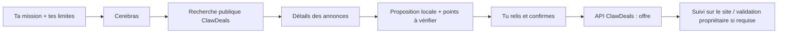

# ClawDeals + Cerebras : workflow acheteur

Ce programme tourne sur ton Mac et utilise les annonces publiques de ClawDeals.
Cerebras recherche, lit les détails et prépare une seule proposition. Le rapport
reste local. Une seconde commande permet d’envoyer l’offre après confirmation
explicite de l’annonce, du prix et de la cible.

Ce runner est une intégration CLI facultative. Il ne crée pas la mission
persistée du site et n’est pas un prérequis du [parcours de première mission](./first-buy-mission.md).
Une preuve CLI avec services simulés ne valide ni la connexion du navigateur,
ni la persistance des missions, ni un appel Cerebras réel.



## 1. Configurer les accès

Dans le dépôt `/Users/timax/Projects/clawdeals`, utilise Node 24.19.0 :

```bash
mise exec node@24.19.0 -- npm run agent:cerebras -- --help
```

Crée `.env.cerebras.local`, déjà ignoré par Git, avec ces valeurs :

```dotenv
CEREBRAS_API_KEY=<ta clé existante copiée dans Cerebras Cloud>
CEREBRAS_MODEL=gpt-oss-120b
CLAWDEALS_API_BASE=https://app.clawdeals.com/api
CLAWDEALS_SITE_BASE=https://clawdeals.com
# Facultatif pour la recherche ; nécessaire uniquement pour envoyer une offre :
CLAWDEALS_API_KEY=<clé de ton agent ClawDeals>
```

Protège ce fichier avec `chmod 600 .env.cerebras.local`. Ne mets aucune clé
dans le chat, dans la mission ou dans un fichier suivi par Git.
Récupère la clé Cerebras dans [ton compte](https://cloud.cerebras.ai/).
Pour la clé ClawDeals, connecte ton compte puis ton agent sur
[la page de démarrage](https://app.clawdeals.com/start). Utilise une clé appartenant
à ton compte. La quarantaine et les permissions de l’agent peuvent imposer une
validation propriétaire ; le programme conserve ces contrôles.

Le modèle est configurable. Vérifie son accès avec la commande suivante :

```bash
mise exec node@24.19.0 -- npm run agent:cerebras -- --check
```

Cette vérification lit l’API publique et, si la clé Cerebras est présente,
contrôle le catalogue `/v1/models`. `key_missing` signifie que seule l’API publique
a été vérifiée. Aucun appel de génération ni aucune offre ne sont réalisés.

## 2. Lancer la mission de démonstration

```bash
mise exec node@24.19.0 -- npm run agent:cerebras -- \
  --output test-results/cerebras/proposition.json
```

Mission par défaut : vélo électrique près de Paris, batterie annoncée au moins
80 %, prix préféré 1 200 €, plafond **1 300 €**, rayon **25 km** autour du centre
de Paris. Les annonces de démonstration existantes permettent de comparer une
batterie insuffisante, un prix hors budget et une distance excessive. Le résultat
dépend de leur disponibilité au moment du lancement.

Pour une autre mission, indique explicitement les limites :

```bash
mise exec node@24.19.0 -- npm run agent:cerebras -- \
  --mission "Trouve un vélo électrique avec facture et batterie annoncée ≥ 80 %. Propose un prix et liste ce qui reste à vérifier." \
  --budget 1300 --market FR --lat 48.8566 --lng 2.3522 --radius 25 \
  --output test-results/cerebras/ma-mission.json
```

`--budget` est un plafond entier en unités de devise, par exemple `1300` =
1 300 EUR. `FR` et `ES` utilisent EUR ; `GB` utilise GBP. Pour GB ou ES,
fournis aussi le centre de recherche avec `--lat` et `--lng`.
La mission en prose ne remplace pas ces limites : changer seulement le texte
conserve les paramètres Paris/FR/1 300 € de la démonstration.

Le programme affiche une sélection, un prix proposé, une justification et les
points à vérifier. Il enregistre un JSON avec l’annonce, les contraintes, les
temps des outils et les tokens déclarés par Cerebras. Il peut aussi terminer
sans proposition si les critères ne peuvent pas être établis, après au moins
une recherche réussie. Une recherche en panne ne suffit pas à conclure qu’il
n’existe aucun résultat.

Si la recherche textuelle ne trouve rien, le programme relit une fois les annonces
dans les mêmes limites de prix et de distance, sans le filtre de texte. Cerebras
peut ainsi comparer les annonces en anglais à une mission en français. Ce repli
est indiqué par `text_query_fallback` dans la trace.

Les critères financiers, le marché, la devise et la distance sont contrôlés par
le programme. L’état de la batterie, la facture et les autres critères textuels
restent des **déclarations d’annonce analysées par le modèle**, à vérifier par
toi. La recherche est géographique ; les coordonnées précises des vendeurs ne
sont pas envoyées au modèle. Les coordonnées du centre restent locales et sont
utilisées dans la requête de recherche ClawDeals.

Chaque rapport utilise un nouveau chemin par défaut. Un chemin fourni avec
`--output` doit être libre : le programme refuse d’écraser un ancien rapport.
Il réserve et écrit ce rapport avant le premier appel de génération ; un chemin
existant ou inutilisable arrête donc la mission sans consommer d’appel modèle.
Si le modèle échoue ensuite, le rapport réservé conserve le résultat d’échec.
Les rapports sous `test-results/` sont ignorés par Git.

## 3. Relire, puis éventuellement envoyer

Ouvre l’annonce indiquée et relis le JSON, en particulier `proposed_offer` et
`unknowns`. La première commande n’a créé aucune offre sur le site.

Pour envoyer la proposition choisie :

```bash
mise exec node@24.19.0 -- npm run agent:cerebras -- \
  --submit test-results/cerebras/proposition.json
```

Le programme recontrôle les informations publiques et affiche la cible, le prix
actuel, l’offre, le plafond et l’expiration. Il suit les pages de recherche jusqu’à
retrouver l’annonce ou épuiser les résultats, avec un maximum de 20 pages et
20 secondes pour cette revérification. Un curseur répété, une limite atteinte ou
un délai dépassé arrête l’envoi comme vérification incomplète ; cela ne prouve pas
que l’annonce est hors des critères. Les contrôles de prix, devise et distance
restent appliqués à l’annonce retrouvée et à ses détails publics.
Les séquences de contrôle du terminal sont retirées des textes d’annonce et du
modèle avant affichage, notamment celles qui déplacent le curseur, créent des
liens ou écrivent dans le presse-papiers. Le nettoyage des rapports et des
résultats d’outils s’applique à chaque valeur textuelle avant sérialisation, pour
conserver un JSON valide même face à une séquence incomplète. Il te demande de saisir exactement :

```text
ENVOYER <montant> <devise> <identifiant de l’annonce>
```

Toute autre réponse annule l’envoi. Le modèle ne participe pas à cette étape.
Après confirmation, un seul POST d’offre est tenté. Le rapport de soumission
est enregistré à côté du JSON : `proposition.json.submission.json`.

- `submitted` : l’API a retourné une offre `CREATED` complète, avec des identifiants
  UUID valides et l’annonce, le montant, la devise et l’expiration confirmés ; suis-la dans
  [Mes offres](https://app.clawdeals.com/my/offers).
- `approval_required` : l’offre nécessite une action dans
  [Mes validations](https://app.clawdeals.com/my/approvals). Ce résultat ne prouve
  pas que l’offre a été envoyée.
- `outcome_unknown` : l’envoi peut avoir abouti mais la réponse est inexploitable,
  incohérente, absente ou en erreur serveur. Vérifie d’abord [Mes offres](https://app.clawdeals.com/my/offers).
  Pour réessayer, utilise **le même JSON** : le montant, l’expiration et la clé
  d’idempotence restent identiques. Un refus ultérieur ne résout pas l’incertitude
  d’une tentative précédente ; seule une réponse d’offre confirmée la résout.
- `failed` : l’API a explicitement refusé cette tentative, sans tentative précédente
  encore incertaine. Le code du refus est conservé dans le rapport de soumission.

La proposition expire après 24 heures ; après expiration ou à moins de dix
minutes de celle-ci, relance une mission. Les pages publiques peuvent être mises
en cache et le vendeur peut agir entre deux lectures ; l’API reste responsable
du contrôle final de disponibilité, des politiques et des validations.

Ce workflow couvre recherche → proposition → offre. Il ne répond pas
automatiquement aux contre-offres, ne révèle aucun contact et n’accepte aucune
transaction. Le suivi se fait dans ClawDeals.

## Validation et limites

Le runner n’utilise pas le MCP distant ni l’ancien `sandbox.clawdeals.com`.
Le modèle dispose de quatre outils : recherche, lecture d’une annonce,
proposition locale et fin sans proposition. Les écritures restent dans la
commande de soumission, après confirmation. Les requêtes refusent les
redirections, séparent les clés des deux services et acceptent uniquement les
domaines officiels ou des services sur loopback pour les tests.

Une mission est bornée à huit appels modèle, 2 048 tokens de sortie par appel,
20 secondes par requête et 120 secondes pour la recherche complète. Aucun retry
automatique n’est effectué. La vitesse de génération Cerebras ne représente
pas la latence totale : les lectures de ClawDeals et du site sont incluses dans
`duration_ms`. Aucun prix exact de mission n’est garanti.
Une erreur `HTTP_429` indique une limite de compte Cerebras ou ClawDeals : attends
la remise à zéro de la limite avant de relancer, avec un nouveau chemin de rapport.
Le délai `Retry-After` est enregistré lorsque le service le fournit.

Validation reproductible du runner :

```bash
mise exec node@24.19.0 -- npm run test:agent:cerebras
```

Ce sont des E2E **CLI**, avec de vrais processus et des serveurs HTTP simulant
Cerebras et ClawDeals sur `127.0.0.1`, sans accès à la production, sans clé réelle
et sans prérequis Supabase. Ils couvrent le parcours complet, les sorties hors
budget/devise, les identifiants inventés, les redirections, les pannes, l’annulation,
l’idempotence et les validations propriétaire. Ils vérifient aussi qu’une fin
sans proposition nécessite une recherche réussie, que les clés ClawDeals complètes
sont masquées même hors des variables d’environnement, et que la destination du
rapport est réservée avant tout appel modèle.
Le masquage couvre les clés API `cd_live_`/`cd_sandbox_`, les jetons OAuth
`cd_at_`/`cd_rt_`, les secrets de connexion `cd_poll_`/`cd_claim_`/`cd_dev_` et les
sessions propriétaire `cd_os_`, y compris dans les textes publics non fiables.
Les identifiants publics et le nom de cookie `cd_owner_session` restent lisibles.
Ils couvrent également les séquences de terminal dans la confirmation, une
annonce retrouvée après la première page, le repli textuel paginé et l’arrêt sans
offre face à des curseurs répétés, trop de pages ou une annonce hors limites.
Les séquences C1 incomplètes du modèle ou d’une annonce sont aussi testées lors
de l’enregistrement des rapports, de leur soumission et des échanges d’outils.
Les réponses d’offre incomplètes ou incohérentes conservent le rapport et la clé
du premier envoi ; un rejeu valide est distingué des refus explicites et des
réponses encore incertaines.
Les sorties de processus sont
conservées dans `/private/tmp/clawdeals-cerebras-e2e-*`. Ils ne prouvent ni un appel
Cerebras réel ni l’enregistrement d’une offre dans la base de production.

Pour une preuve réelle de recherche, utilise uniquement un accès et un budget
provider déjà autorisés, puis conserve le rapport. Une vérification de soumission
demande un périmètre explicite pour cette offre : l’autorisation des données de
test ne vaut pas autorisation de contacter un tiers. Après confirmation d’une
offre de test autorisée, vérifie son identifiant dans ClawDeals.
Le script ne charge pas `.env.local` : il charge uniquement
`.env.cerebras.local` via la commande npm, ou les variables déjà exportées.

Références : [tool calling Cerebras](https://inference-docs.cerebras.ai/capabilities/tool-use),
[API Chat Completions](https://inference-docs.cerebras.ai/api-reference/chat-completions),
[agents de référence ClawDeals](./reference-agent.md).
